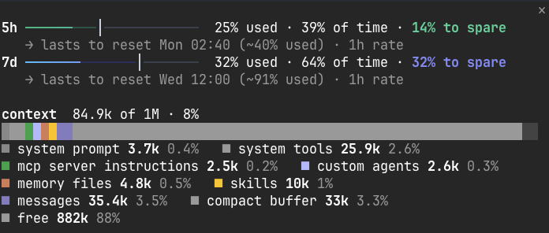
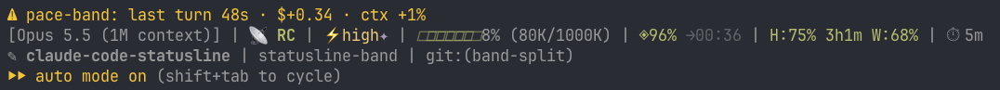

# Pace Band

A [Claude Code mod](https://code.claude.com/docs/en/plugins/mods/): companion to the [pace-statusline](../../README.md) status line. It shows what a status line cannot.

## `/pace`

A pane, opened and closed by `/pace` (`/pace en|ru|auto` sets the language, see [Language](#language); `/pace <seconds>` the refresh, see [Refresh](#refresh); either one, once it is set, opens the pane too when it is closed, and never closes it):



The same as text:

```
5h ━━━━━━━━┃━━━━━━━━━━━━━━━━━━━━━━━━━━━━  12% used · 72% of time · 60% to spare
   → lasts to reset Sun 00:40 (~19% used) · 1h rate
7d ━━━━━━━━━━━━━━━━━━━━┃━━━━━━━━━━━━━━━━━  19% used · 50% of time · 31% to spare
   → runs out Tue 21:06 (in 2d 21h), 14h 54m before reset · 1h rate

fleet  3 sessions · last hour $9.50 · 5h window $10.50
  tsalkin-ai              $7.00 74%     $7.00   now   cache cold, 175k to re-cache
▸ Fix the login flow      $2.50 26%     $2.50   20m ago   cache → 14:32
  yadro                   $0.00 0%      $1.00   1h 30m ago   cache cold, 60k to re-cache

context  95.7k of 1M · 10%
█████████████████████████████████████████
■ system prompt 3.7k 0.4%   ■ messages 46.2k 4.6%   ■ free 871k 87%
```

- **Each limit window against its time.** The bar's fill is the share of the limit used, the `┃` is the share of the window's time gone. `to spare` means the limit is spent slower than its time, by that many percent of the limit; `ahead` means faster.
- **Two palettes per window, by the fact.** In reserve: the 5-hour bar green to cyan, the weekly one blue to violet, and the stretch up to `┃` tinted: that is the reserve. Short: amber or pink up to `┃`, red beyond it: that is the overshoot.
- **The forecast.** At the last hour's rate (`1h rate`), or the window's average when there is no reading 10–90 minutes old (`avg rate`). Quiet when the limit lasts to its reset; amber when it runs out while still in reserve; red when it runs out and is already short.
- **The fleet.** Every session on this machine spends the same 5-hour window. With two or more sessions in the window, `/pace` lists them, the one that spent most in the last hour first: what each spent in the last hour (its share of all of them) and in the window, when it last moved, and its prompt cache (warm until when, or cold and how many tokens its next request re-caches). `▸` is this session; the top spender is red when it took half the hour or more, a cold cache amber. The amounts are the sessions' own costs at list price, as `/cost` counts them, so the split is exact even when sessions run at once; the window's limit points are account-wide and cannot be split. The name and the cache come from the [pace-statusline](../../README.md) line; without it a session shows under its project's folder and with no cache.
- **The agents of the last turn.** Every agent the last turn started, with the model it runs on, where it stands and, once it has ended, the tokens it used (`ispolnitel · opus · done · 1.2M tok  build the parser`). A press on a row opens that agent's transcript in the main view.
- **The context by category**, as `/context` counts it, estimated locally.

Readings are kept in the mod's store, shared by every session on the machine: they all spend one account's limits, so the forecast counts all of them.

## The last turn, and the band

**What the last turn cost** goes to the end of the [pace-statusline](../../README.md) line's second line, dim, replaced after each turn: `last turn 12s · $+0.42 · ctx +3% · 5h +1`. The status line cannot tell where a turn ends; the mod can, and after each turn writes that text to `pace-band-turn-<session>.txt` in the temporary directory (`$TMPDIR`), where the line reads it. Only sessions with a screen write it: a headless run (`claude -p`, a scripted session) shows no line. The limit figure is the account's: other sessions spending at the same time count in it. A turn that started agents ends with their share of its tokens, `agents 61% tok`: every kind of token together (input, output, cache read and written), the agents' against theirs plus the main loop's own; rewritten when an agent ends after the turn. Tokens, not dollars: the engine reports an agent's work in tokens, and tokens of different models cost differently, so the share in tokens is not the share in money. Without the pace-statusline line nothing shows the last turn: a mod's own status line would be a second line under the prompt.



**The band** above the prompt shows only when there is something to act on, and stays away otherwise:
- a `compact` button past 80 % context;
- a limit window that runs out before its reset at this rate: `5h ⇡+12 → out Mon 02:15` in red when it is already spent ahead of its time, `7d 30% to spare → out Mon 22:52` in yellow when it is still in reserve and only the rate is too fast. A window spent ahead of its time that still lasts to its reset gets no band: the status line's `⇡` already says it.

The warning is one press away from `/pace`: click it, or `p` once the band holds the focus (ctrl+x tab). `×` hides the band for the session.

**A quiet word under the prompt.** At the end of the hint line (`? for shortcuts`), dim, for each window spent ahead of its time or running out before its reset: `5h ⇡6 · ~94% at reset · /pace` when it still lasts, `5h out 14:20 · /pace` when it does not. Terminal only. It asks nothing of you; the band is for what does.

**A notification** goes with the band's warning when a limit window starts to run out before its reset: one native notification per window and reset, through your own notification channel (`preferredNotifChannel`), for a terminal out of sight. Every session on the machine shares it, so two sessions do not say it twice. Turned off with Claude Code's notifications.

**An agent below its definition.** When an agent starts on a smaller model family than its definition names (`~/.claude/agents/`, or the project's `.claude/agents/`, which wins), a toast says so: `agent ispolnitel starts on sonnet, its definition names opus`. The spawn goes on as asked: the mod never changes it. The [pace-statusline](../../README.md) subagent rows show the same while the agent runs.

## Refresh

Claude Code draws the band, the hint under the prompt and `/pace` again only on its own events: a turn, a measurement, a press. A session left idle would keep a forecast measured against an old time and miss what other sessions spent. So the mod refreshes them on a timer, every 30 seconds by default: it reads the readings every session stored, the fleet when `/pace` is open, and asks for a redraw. `/pace 10` sets the period (5 to 3600 seconds), `/pace 0` turns it off, as does `/config` → `pace-band.refresh`. Only sessions with a screen run the timer. The [pace-statusline](../../README.md) line has its own timer, set in `settings.json` (`"refreshInterval": 30` under `statusLine`): a mod cannot change that file.

## Language

English or Russian, for `/pace` and the [pace-statusline](../../README.md) line together, independent of the language Claude answers in. `/pace en`, `/pace ru` or `/pace auto` sets it, as does `/config` → `pace-band.language`, the plugin's `language` option: `auto` (the default) follows Claude Code's own `language` setting. The status line reads the same option from `settings.json`; its own `STATUSLINE_LANG=en|ru` still pins the line alone. In Russian the forecast reads `кончится Вт 21:06 (через 2д 21ч), за 14ч 54м до сброса · темп за час`.

## Install

```
/plugin marketplace add tsalkin/claude-code-statusline
/plugin install pace-band@tsalkin
```

Needs Claude Code 2.1.300 or later, in the terminal or the Desktop app's Code tab (mods draw nothing in VS Code, `claude -p` or cloud sessions). Limit windows come with a Claude subscription; on an API key `/pace` shows the context only.

Mods are not sandboxed and run with your permissions. `claude plugin validate` lists every hook and call this one makes. It reads the session's usage figures and the agent definitions (`~/.claude/agents/`, the project's `.claude/agents/`), and writes its own store and two small files per interactive session in the temporary directory: the last turn, for the line, and the session's cost over the last five hours, `pace-band-fleet-<session>.json`, for the fleet. `/pace` reads those of every session, and the line's `pace-band-line-<session>.json` (name and cache). It makes no network requests of its own (the `compact` button runs Claude Code's own compaction).

## Tests

```
cd experiments/statusline-band && claude plugin test
```
